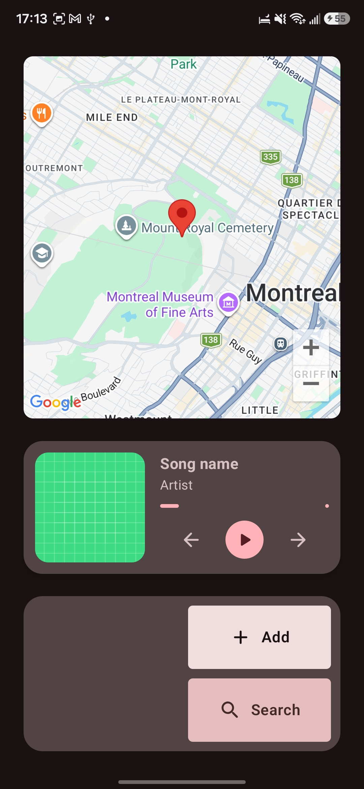
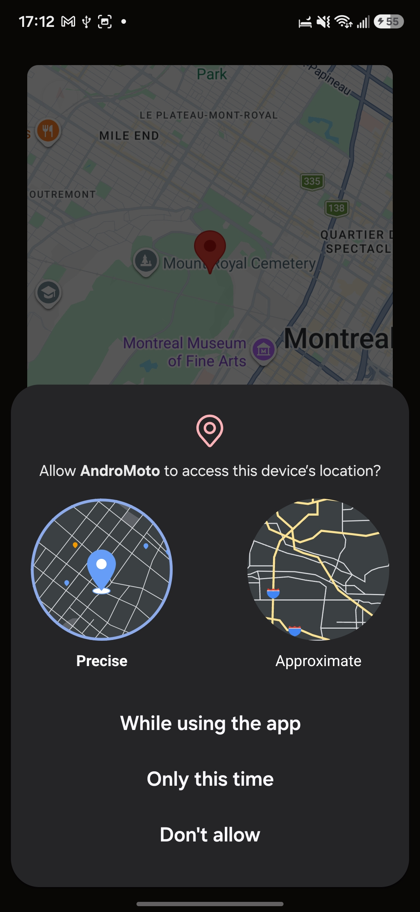
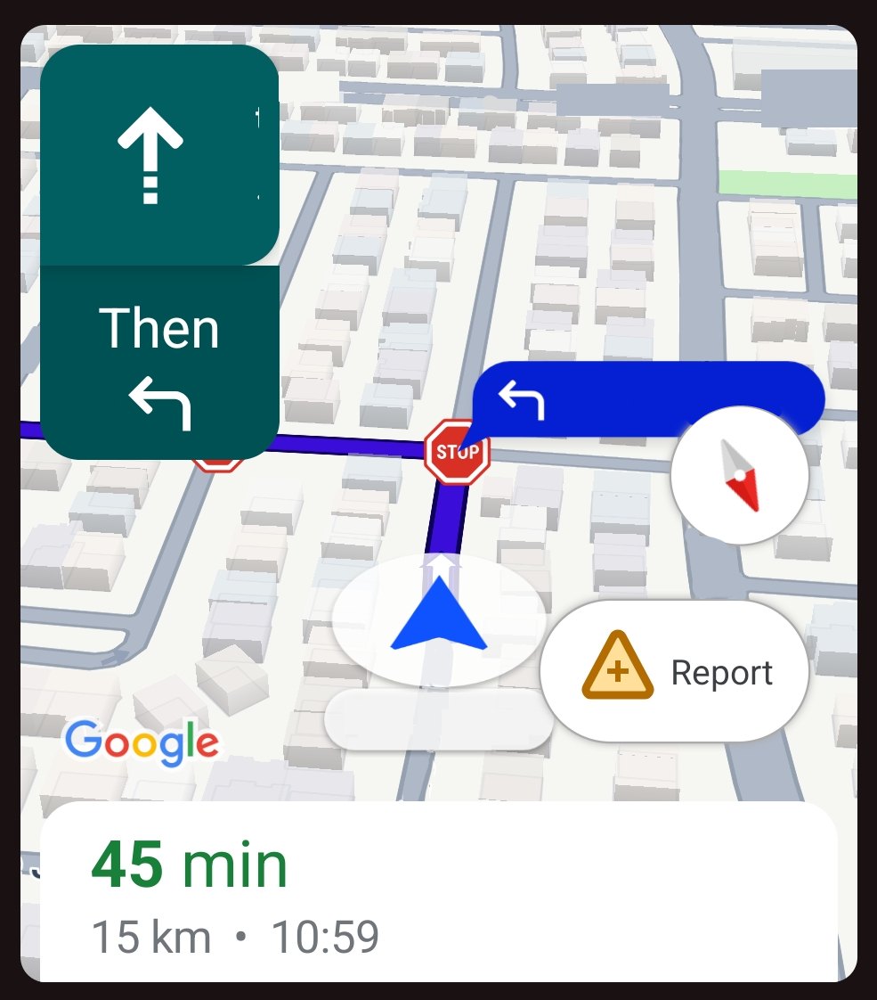
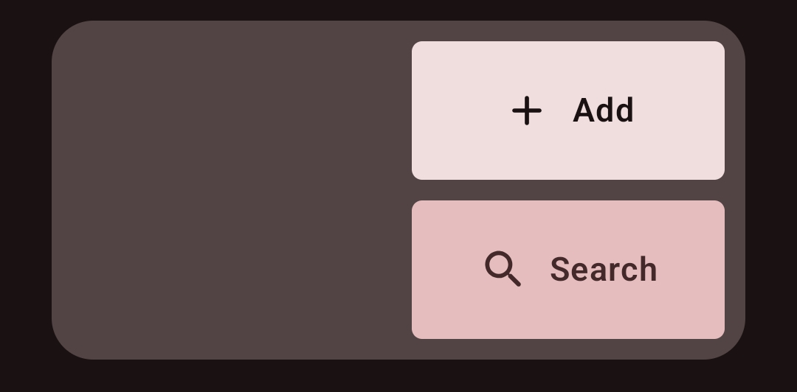
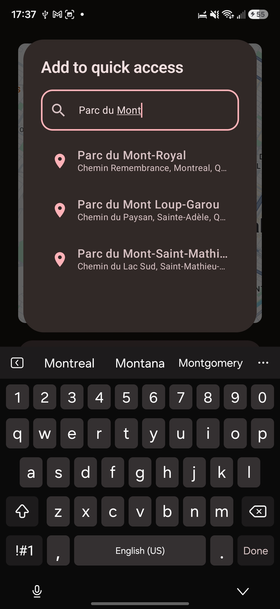
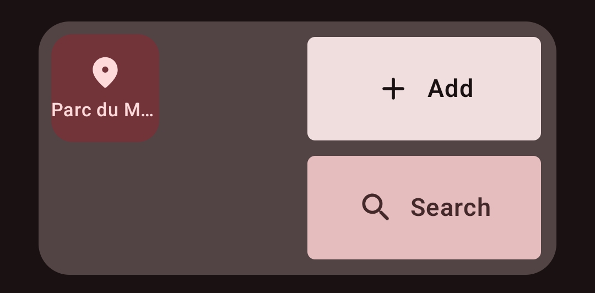

  <h1>🏍️ Android Moto</h1>
  
<i>Un tableau de bord style Apple CarPlay / Android Auto pour la navigation et la musique. An Apple CarPlay / Android Auto style dashboard for navigation & music control.</i>

  
<b>Par / By:</b> Jack Adam's Dieujuste &nbsp;|&nbsp; <b>Date:</b> Octobre / October 2026

---

## Aperçu / Overview

<table width="100%">
<tr>
<th width="50%">🇫🇷 Français</th>
<th width="50%">🇬🇧 English</th>
</tr>
<tr>
<td valign="top">

Je voulais contrôler ma musique et voir la carte simultanément lorsque je suis en moto, comme avec **CarPlay / Android Auto**. Vu que ça n'existe pas pour les téléphones, j'ai fait le mien.

</td>
<td valign="top">

I wanted to easily control my music and see the map when riding, **CarPlay / Android Auto** style. Since that isn't available for phones, I made my own.

</td>
</tr>
</table>

  <h3>État actuel / Current App State</h3>
  

---

## Permissions

<table width="100%">
<tr>
<th width="50%">🇫🇷 Français</th>
<th width="50%">🇬🇧 English</th>
</tr>
<tr>
<td valign="top">

Avant de lancer la navigation, l'app requiert la permission de **localisation précise**.

> **Mise à jour :** l'app reste utilisable sans permissions. Une simple carte remplace l'interface de navigation.

</td>
<td valign="top">

Before launching navigation, the app requires permission for **precise location access**.

> **Update:** the app stays usable without location permissions. You get a simple map instead of navigation.

</td>
</tr>
</table>

<table width="100%">
  <tr>
    <td width="50%" align="center" valign="top">
      <h4>1. Permission</h4>
      
    </td>
    <td width="50%" align="center" valign="top">
      <h4>2. Si refusée / If denied</h4>
      
    </td>
  </tr>
</table>

---

## Composantes principales / Core Components

<table width="100%">
<tr>
<th width="50%">🇫🇷 Français</th>
<th width="50%">🇬🇧 English</th>
</tr>
<tr>
<td valign="top">

Navigation avec le **Google Navigation SDK** : guidage en temps réel, un mini Google Maps intégré à mon app.

</td>
<td valign="top">

Navigation uses the **Google Navigation SDK**: real-time turn-by-turn guidance, a mini Google Maps inside my app.

</td>
</tr>
</table>

<table width="100%">
  <tr>
    <td width="50%" align="center" valign="top">
      <h4>Inactif, localisation activée Idle, location enabled</h4>
      
    </td>
    <td width="50%" align="center" valign="top">
      <h4>Navigation démarrée Navigation started</h4>
      
    </td>
  </tr>
</table>

---

## Barre d'accès rapide / Quick Access Bottom Bar

<table width="100%">
<tr>
<th width="50%">🇫🇷 Français</th>
<th width="50%">🇬🇧 English</th>
</tr>
<tr>
<td valign="top">

Interactions faciles, même avec des gants. Glissez à droite ou à gauche pour passer d'une barre à l'autre.

* **Démarrer la navigation :** itinéraire rapide vers vos favoris.
* **Enregistrer des adresses :** ajoutez des destinations à vos favoris.
* **Recherche :** cherchez et naviguez sans enregistrer.
* **Changeur de playlist :** contrôle audio simple.
* **Contrôles de la carte :** réglages de la carte en un geste.

</td>
<td valign="top">

Easy interactions, even when gloved. Swipe right or left to switch between the two bars.

* **Start Navigation:** quick route to favorite locations.
* **Save Addresses:** add new destinations to your favorites.
* **One-Time Search:** search and navigate without saving.
* **Playlist Switcher:** easy peasy audio control.
* **Map Controls:** toggle map settings in one tap.

</td>
</tr>
</table>

<table width="100%">
  <tr>
    <td width="50%" align="center" valign="top">
      
       <b>Adresses / Waypoints</b>
    </td>
    <td width="50%" align="center" valign="top">
      
       <b>Actions de la carte / Maps Quick Actions</b>
    </td>
  </tr>
</table>

### Recherche d'adresse / Address Search

<table width="100%">
<tr>
<th width="50%">🇫🇷 Français</th>
<th width="50%">🇬🇧 English</th>
</tr>
<tr>
<td valign="top">

* En mode ajout, appuyer sur une adresse l'ajoute aux favoris.
* En mode recherche, appuyer sur une adresse lance la navigation.

</td>
<td valign="top">

* If adding, pressing an address adds it to favorites.
* If searching, pressing an address starts navigation to it.

</td>
</tr>
</table>

<table width="100%">
  <tr>
    <td width="50%" align="center" valign="top">
      
       <b>Ajout / Adding</b>
    </td>
    <td width="50%" align="center" valign="top">
      
       <b>Après l'ajout / After adding</b>
    </td>
  </tr>
</table>

---

## Widget de musique / Music Widget

<table width="100%">
<tr>
<th width="50%">🇫🇷 Français</th>
<th width="50%">🇬🇧 English</th>
</tr>
<tr>
<td valign="top">

Utilise le **SDK / l'API Spotify** pour accéder à ma bibliothèque et contrôler la lecture en temps réel.

> **À venir :** pochette, progression, titre, artiste, etc. seront affichés correctement.

</td>
<td valign="top">

Uses the **Spotify SDK/API** to access my library and control playback in real time.

> **Coming soon:** artwork, progress, title, artist, etc. will be displayed properly.

</td>
</tr>
</table>

  

