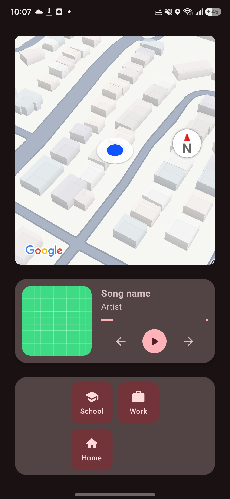
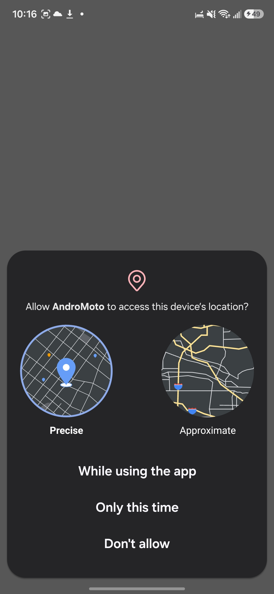
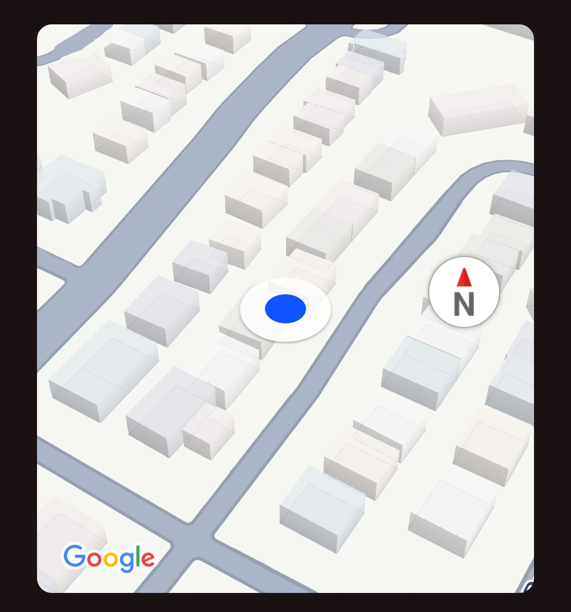
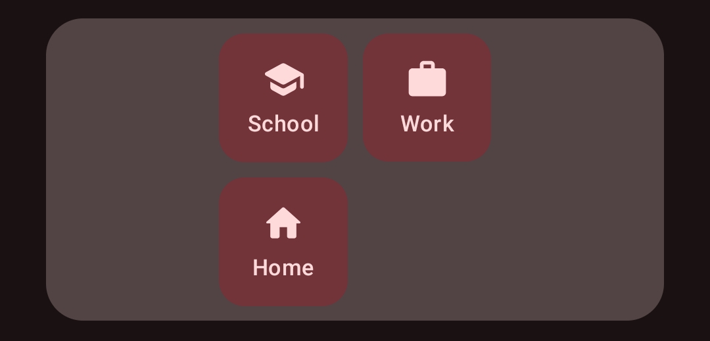
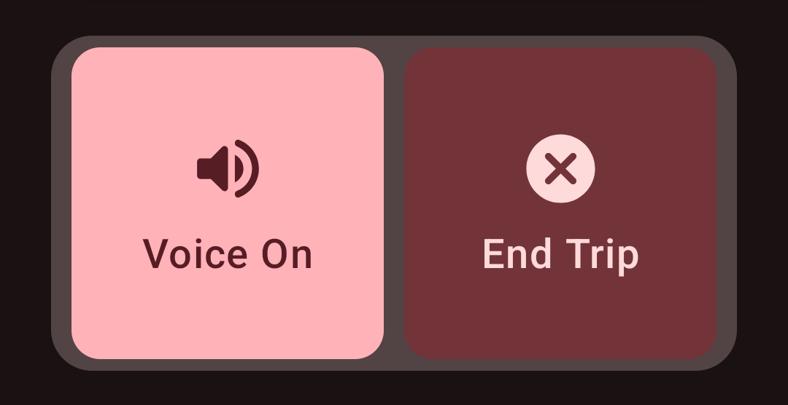
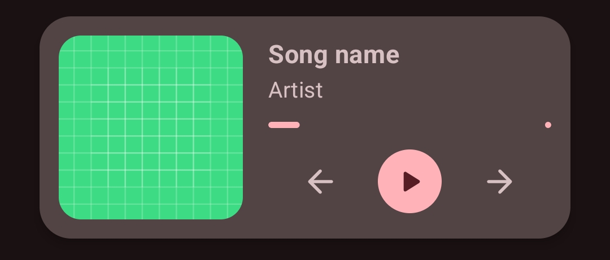

  <h1>🏍️ Android Moto</h1>
  
<i>An Apple CarPlay / Android Auto style dashboard built for navigation & music control.</i>

  

    <b>By:</b> Jack Adam's Dieujuste &nbsp;|&nbsp; <b>Date:</b> October 2026
  

  ---

 

## Overview

I wanted to be able to easily control music and navigation **Apple CarPlay/Android Auto** style, but it wasn't available for your phone so I made my own.

 

  <h3>Current App State</h3>
  

 

---

## Permissions

Before launching navigation, the app requires permission for **precise location access**.

<table width="100%">
  <tr>
    <td width="50%" align="center" valign="top">
      <h4>1. Request Permission</h4>
      
    </td>
    <td width="50%" align="center" valign="top">
      <h4>2. Location Access Denied</h4>
      
    </td>
  </tr>
</table>

> **Planned Update:** *Adjust permission handling so non-location features are available even if location access is denied.*

 

---

## Core Components

For the navigation I used the **Google Navigation SDK** which gets you real-time turn by turn navigation. Essentially giving me a mini google maps running inside of my app.

  

 

### Quick Access Bottom Bar
A dedicated control bar designed for fast, gloved touch interactions on the go:

<table width="100%">
  <tr>
    <td width="50%" align="center" valign="top">
      
       <b>Waypoints & Addresses</b>
    </td>
    <td width="50%" align="center" valign="top">
      
       <b>Maps Quick Actions</b>
    </td>
  </tr>
</table>

* **Start Navigation:** Quick route to pre-saved favorite locations.
* **Save Addresses:** Add new destinations directly to your quick-start grid.
* **One-Time Search:** Search and navigate without saving to your grid.
* **Playlist Switcher:** Audio control on the move.
* **Map Controls:** Easily toggling maps settings

 

### Music Widget
The music widget will use the **Spotify SDK/API** for access to my library and real time play-back control.

> **Future Update:** *When implemented, album artwork, song progress, name, artist, etc... will be dislayed properly*

  

